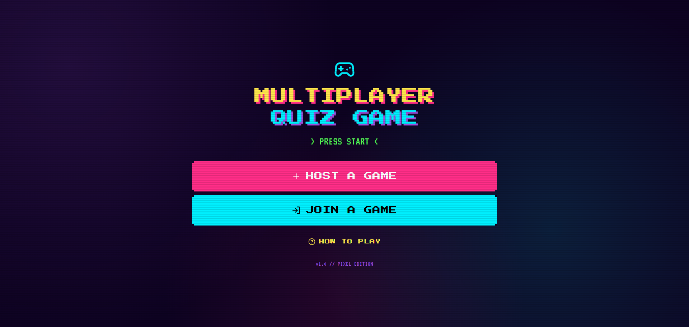

# Multiplayer-style quiz game

> Built by **Harshit Kamra** for the Generative AI Assessment Track (Creative & Interactive).

**Live Demo:**https://multiplayer-quiz-gam-ylc1.bolt.host*  
**GitHub Repository:** https://github.com/harshit-kamra/multiplayer-style-quiz-game  
**Submission Form:** https://forms.gle/4u63uAuy5ygU3q9b9

---
 
## Project Overview
A live quiz game where a host creates a room code, players join, and scores update on a leaderboard.

## Implemented Must-Haves
- [x] Host creates room code
- [x] players join
- [x] live scoreboard
- [x] question timer

## Key Learning Outcomes
- Implement real-time sync
- manage rooms and players
- build a live scoreboard.

## Tech Stack
- **Frontend:** HTML5, CSS3, JavaScript (or React / Vite / Next.js)
- **AI & Logic:** Generative AI prompt engineering, external APIs, state management
- **Deployment:** Vercel / Netlify / GitHub Pages (Deploy anywhere with zero restrictions!)

## How to Run Locally
1. Clone this repository:
   ```bash
   git clone https://github.com/YOUR-USERNAME/multiplayer-style-quiz-game.git
   ```
2. Navigate into the project directory:
   ```bash
   cd multiplayer-style-quiz-game
   ```
3. Open `index.html` directly in your browser, or run your local dev server:
   ```bash
   # If using npm / Vite:
   npm install
   npm run dev
   ```

## Demo Preview Screenshot


## Author
- **Harshit Kamra**
- Student #22 · Project #45
